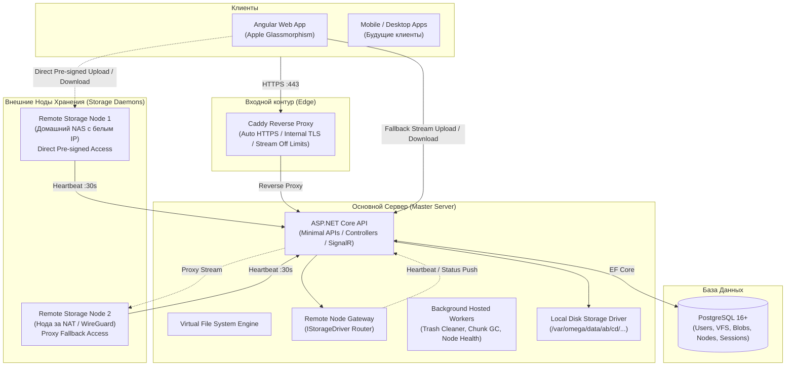
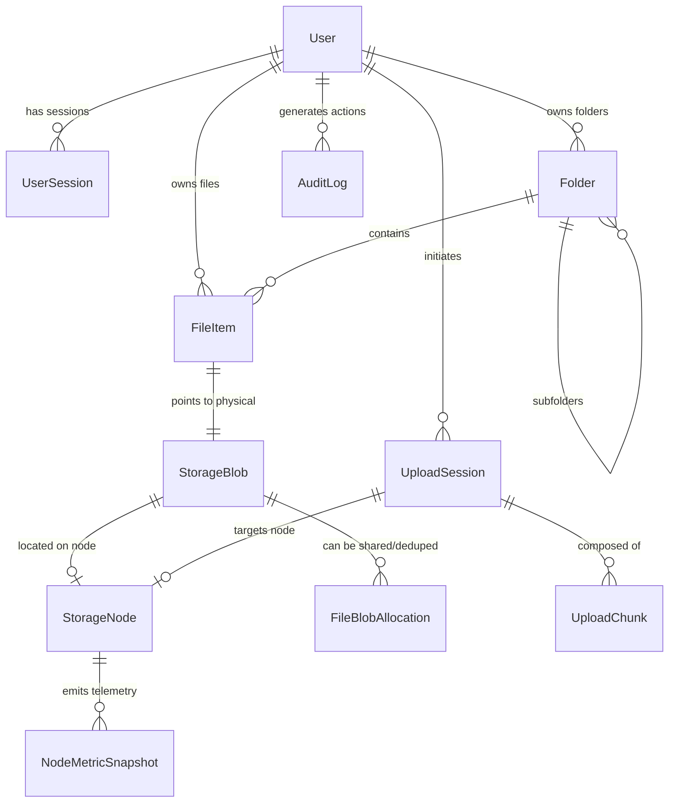

# 🌌 Omega Cloud — Архитектурный Мастер-План (Master Server)

> **Статус документа:** Утверждено на основе архитектурного опроса (`/grill-me`).  
> **Версия системы:** 1.0 (Master-first с масштабируемой нодовой архитектурой).  
> **Основной стек:** ASP.NET Core (.NET 10 / 9), Entity Framework Core, PostgreSQL 16+, Angular 19+ (Standalone, Signals), Caddy 2, Docker Compose.

---

## 1. Концепция и глобальная архитектура системы

**Omega Cloud** — приватное высокопроизводительное self-hosted облако файлов с элегантным интерфейсом в стиле **Apple Glassmorphism** и распределенной архитектурой хранения данных.

Система разделена на два фундаментальных контура:
1. **Control Plane (Управляющий контур):** Метаданные пользователей, дерево каталогов (VFS), права доступа, аудит, мониторинг нод и координация передачи данных. Живет строго на **Master Server**.
2. **Data Plane (Контур передачи данных):** Физический стриминг байтов. Работает по **гибридной схеме**:
   - Локальное хранилище на самом Master-сервере (Local Storage Driver).
   - Внешние удаленные ноды хранения (Remote Storage Daemons) через **Pre-signed Direct URL** с подписанным HMAC-токеном. Если нода за строгим NAT без белого IP — мастер осуществляет прозрачное fallback-проксирование потока.



---

## 2. Детальная схема сущностей PostgreSQL (EF Core)

Архитектура базы данных построена на принципе **разделения логической виртуальной файловой системы (VFS) и физического хранения блоков (Content-Addressable Storage / UUID Storage)**. Это предотвращает порчу путей файловой системы ОС, снимает ограничения на спецсимволы и готово к дедупликации данных.



### 2.1. Таблицы авторизации, пользователей и сессий

#### `Users`
- `Id` (`uuid`, PK)
- `Username` (`varchar(64)`, Unique, Index)
- `Email` (`varchar(256)`, Unique, Index)
- `PasswordHash` (`varchar(512)`) — Argon2id / PBKDF2
- `Role` (`varchar(32)`) — `Admin`, `User`, `Guest`
- `AllocatedQuotaBytes` (`bigint`) — выделенная квота (например, 100 ГБ)
- `UsedQuotaBytes` (`bigint`) — фактически занятый объем (включая корзину)
- `IsActive` (`boolean`, default: `true`)
- `CreatedAt` (`timestamptz`), `UpdatedAt` (`timestamptz`)

#### `UserSessions`
- `Id` (`uuid`, PK)
- `UserId` (`uuid`, FK -> `Users.Id`, Cascade)
- `RefreshTokenHash` (`varchar(256)`, Index)
- `DeviceName` (`varchar(128)`) — e.g. "MacBook Pro Safari", "Windows PC Chrome"
- `IpAddress` (`varchar(45)`)
- `UserAgent` (`text`)
- `CreatedAt` (`timestamptz`)
- `ExpiresAt` (`timestamptz`)
- `LastActiveAt` (`timestamptz`)
- `RevokedAt` (`timestamptz`, Nullable)
- `ReplacedByTokenHash` (`varchar(256)`, Nullable) — защита от повторного использования токена (Token Rotation Attack)

---

### 2.2. Виртуальная файловая система (VFS)

#### `Folders`
- `Id` (`uuid`, PK)
- `UserId` (`uuid`, FK -> `Users.Id`, Index)
- `ParentFolderId` (`uuid`, FK -> `Folders.Id`, Nullable, Index) — `null` для корневой папки пользователя
- `Name` (`varchar(255)`)
- `Color` (`varchar(32)`, Nullable) — цветовая маркировка папки (Apple Style)
- `IsDeleted` (`boolean`, default: `false`, Index)
- `DeletedAt` (`timestamptz`, Nullable)
- `CreatedAt` (`timestamptz`), `UpdatedAt` (`timestamptz`)
- *Unique Constraint:* `(UserId, ParentFolderId, Name, IsDeleted)`

#### `FileItems` (Логический файл)
- `Id` (`uuid`, PK)
- `UserId` (`uuid`, FK -> `Users.Id`, Index)
- `FolderId` (`uuid`, FK -> `Folders.Id`, Nullable, Index) — `null` = корень диска
- `StorageBlobId` (`uuid`, FK -> `StorageBlobs.Id`, Index)
- `Name` (`varchar(255)`)
- `Extension` (`varchar(32)`)
- `MimeType` (`varchar(128)`)
- `SizeBytes` (`bigint`)
- `IsDeleted` (`boolean`, default: `false`, Index) — флаг Корзины
- `DeletedAt` (`timestamptz`, Nullable) — время отправки в Корзину (для автоочистки через 30 дней)
- `IsFavorite` (`boolean`, default: `false`)
- `CreatedAt` (`timestamptz`), `UpdatedAt` (`timestamptz`)

---

### 2.3. Физическое хранение и ноды

#### `StorageNodes` (Реестр нод хранения)
- `Id` (`uuid`, PK)
- `Name` (`varchar(128)`) — например, "Home-NAS-Synology", "VPS-Local-NVMe"
- `RegistrationKey` (`varchar(128)`, Unique) — одноразовый/постоянный токен сопряжения
- `NodeSecretHash` (`varchar(256)`) — для HMAC-подписи запросов к ноде
- `Type` (`varchar(32)`) — `LocalDisk`, `RemoteDaemon`
- `BaseUrl` (`varchar(256)`, Nullable) — публичный адрес ноды для Direct Access
- `IsBehindNat` (`boolean`, default: `false`) — флаг необходимости проксирования через Мастер
- `Status` (`varchar(32)`) — `Online`, `Degraded`, `Offline`, `Maintenance`
- `TotalSpaceBytes` (`bigint`)
- `AvailableSpaceBytes` (`bigint`)
- `LastHeartbeatAt` (`timestamptz`, Index)
- `CreatedAt` (`timestamptz`)

#### `StorageBlobs` (Физический неизменяемый блоб данных)
- `Id` (`uuid`, PK) — UUID для файловой системы ноды
- `StorageNodeId` (`uuid`, FK -> `StorageNodes.Id`, Index)
- `Sha256Hash` (`varchar(64)`, Index) — хеш содержимого (CAS)
- `SizeBytes` (`bigint`)
- `StorageRelativePath` (`varchar(512)`) — шардированный путь, напр. `blobs/e3/b0/e3b0c44298fc...`
- `ReferenceCount` (`integer`, default: `1`) — счетчик логических ссылок (дедупликация)
- `CreatedAt` (`timestamptz`)

---

### 2.4. Сессии докачиваемой загрузки (Resumable Chunk Sessions)

#### `UploadSessions`
- `Id` (`uuid`, PK)
- `UserId` (`uuid`, FK -> `Users.Id`, Index)
- `TargetFolderId` (`uuid`, FK -> `Folders.Id`, Nullable)
- `StorageNodeId` (`uuid`, FK -> `StorageNodes.Id`)
- `FileName` (`varchar(255)`)
- `TotalSizeBytes` (`bigint`)
- `ChunkSizeBytes` (`integer`) — размер одного чанка (например, 20 МБ)
- `TotalChunks` (`integer`)
- `ExpectedSha256` (`varchar(64)`, Nullable)
- `Status` (`varchar(32)`) — `Created`, `Uploading`, `Assembling`, `Completed`, `Aborted`, `Expired`
- `TempStoragePath` (`varchar(512)`)
- `CreatedAt` (`timestamptz`)
- `ExpiresAt` (`timestamptz`, Index) — для сборщика зависших загрузок

#### `UploadChunks`
- `Id` (`uuid`, PK)
- `UploadSessionId` (`uuid`, FK -> `UploadSessions.Id`, Cascade, Index)
- `ChunkIndex` (`integer`) — порядковый номер (0-based)
- `SizeBytes` (`bigint`)
- `Sha256Hash` (`varchar(64)`)
- `IsUploaded` (`boolean`, default: `true`)
- `UploadedAt` (`timestamptz`)

---

### 2.5. Аудит и безопасность

#### `AuditLogs`
- `Id` (`bigserial`, PK)
- `UserId` (`uuid`, Nullable, Index)
- `Action` (`varchar(64)`) — `UserLogin`, `FileUploaded`, `FileDownloaded`, `FileDeleted`, `TrashEmptied`, `NodeRegistered`, `NodeWentOffline`
- `Resource` (`varchar(128)`)
- `ResourceId` (`varchar(64)`, Nullable)
- `IpAddress` (`varchar(45)`)
- `DetailsJson` (`jsonb`)
- `Timestamp` (`timestamptz`, default: `now()`, Index)

---

## 3. Спецификация REST API и SignalR Hub

Базовый префикс всех API: `/api/v1`. Все эндпоинты (кроме Auth и Health) защищены атрибутом `[Authorize]`.

### 3.1. Аутентификация и управление устройствами (`/api/v1/auth`)

| Метод | Эндпоинт | Описание |
|---|---|---|
| `POST` | `/auth/login` | Вход (логин/пароль + User-Agent). Возвращает `AccessToken` (JWT 15 мин) и `RefreshToken` (HttpOnly Cookie / JSON). |
| `POST` | `/auth/refresh` | Ротация токена. Инвалидирует старый `RefreshToken`, выдает новую пару. |
| `POST` | `/auth/logout` | Отзыв текущей сессии в `UserSessions`. |
| `GET` | `/auth/sessions` | Список всех активных устройств текущего пользователя (IP, Браузер, Время последней активности). |
| `DELETE` | `/auth/sessions/{id}` | Удаленный выход (отзыв) конкретного устройства. |
| `GET` | `/auth/me` | Данные текущего пользователя (профиль, роль, квота занято/всего). |

### 3.2. Файлы и папки (`/api/v1/files`, `/api/v1/folders`)

| Метод | Эндпоинт | Описание |
|---|---|---|
| `GET` | `/folders/{id?}` | Получение содержимого папки (`null` = root). Возвращает список подпапок, файлов, breadcrumbs и свободное место. |
| `POST` | `/folders` | Создание новой папки `{ name, parentFolderId, color }`. |
| `PATCH` | `/folders/{id}` | Переименование / сменить цвет / переместить папку. |
| `DELETE` | `/folders/{id}` | Мягкое удаление папки и ее содержимого в Корзину. |
| `GET` | `/files/{id}/metadata` | Получение метаданных файла, статуса ноды, истории. |
| `GET` | `/files/{id}/download` | Запрос на скачивание. Если нода с прямым доступом — возвращает `{ redirectUrl: "https://node.domain/download?token=..." }`. Если нода локальная или за NAT — сервер стримит байты через `IAsyncEnumerable / FileStreamResult`. |
| `PATCH` | `/files/{id}` | Переименование, перемещение в другую папку, переключение `isFavorite`. |
| `DELETE` | `/files/{id}` | Перемещение файла в Корзину (`IsDeleted = true`). |
| `GET` | `/trash` | Получение списка всех файлов и папок в корзине пользователя. |
| `POST` | `/trash/restore/{id}` | Восстановление файла/папки из корзины в исходное или корневое место. |
| `DELETE` | `/trash/permanent/{id}` | Физическое удаление отдельного файла из корзины с освобождением квоты. |
| `DELETE` | `/trash/empty` | Полная очистка всей корзины пользователя. |

### 3.3. Гибридный транспорт загрузки (`/api/v1/upload`)

```mermaid
sequenceDiagram
    autonumber
    actor Client as Angular Web Client
    participant Master as Master Server (ASP.NET Core)
    participant Node as Storage Node / Local Driver
    participant DB as PostgreSQL

    alt Мелкий файл (< 50 МБ)
        Client->>Master: POST /upload/direct-stream (Multipart / PipeReader)
        Master->>Master: Проверка квоты пользователя
        Master->>Node: Стриминг потока байтов на диск/ноду
        Master->>DB: Запись FileItem + StorageBlob, обновление UsedQuota
        Master-->>Client: 201 Created (FileItem)
    else Большой файл (> 50 МБ, Resumable Chunks)
        Client->>Master: POST /upload/sessions/init { fileName, size, totalChunks, sha256 }
        Master->>Master: Валидация квоты и выбор целевой ноды
        Master->>DB: Создание UploadSession
        Master-->>Client: 200 OK { sessionId, chunkSizeBytes, uploadMode: Direct | Proxy, targetUrl }
        
        loop Для каждого чанка (0..N)
            Client->>Master: PUT /upload/sessions/{id}/chunks/{index} (или напрямую в Ноду)
            Master->>Node: Запись чанка в temp-директорию
            Master->>DB: Регистрация UploadChunk
            Master-->>Client: 200 OK { chunkIndex, status: "Saved" }
        end

        Client->>Master: POST /upload/sessions/{id}/complete
        Master->>Node: Команда асинхронной сборки чанков в единый Blob
        Master->>DB: Атомарная фиксация FileItem + StorageBlob + списание квоты
        Master-->>Client: 201 Created (FileItem)
        Master-)-Client: SignalR Event: FileUploaded
    end
```

### 3.4. Управление и регистрация нод (`/api/v1/nodes`)

| Метод | Эндпоинт | Доступ | Описание |
|---|---|---|---|
| `POST` | `/nodes/register` | Node Auth | Первичная регистрация Storage Daemon по `RegistrationKey`. Мастер возвращает `NodeId` и `NodeSecret`. |
| `POST` | `/nodes/heartbeat` | Node Auth (HMAC) | Регулярный пуш телеметрии от ноды каждые 15–30 сек (`TotalSpace`, `AvailableSpace`, `CpuLoad`, `DiskStatus`). |
| `GET` | `/admin/nodes` | Admin Only | Полный список подключенных нод с текущим статусом (Online/Offline/Degraded), дисковыми объемами и задержкой. |
| `POST` | `/admin/nodes/generate-token` | Admin Only | Генерация одноразового ключа регистрации для развертывания новой ноды. |
| `DELETE` | `/admin/nodes/{id}` | Admin Only | Отключение/архивация ноды. |

### 3.5. SignalR Hub (`/hubs/omega`)

Подключение по WebSocket с передачей JWT в `access_token` query-параметре:
- **`NodeStatusChanged(nodeId, status, lastSeen)`** — уведомление админам о падении или восстановлении ноды.
- **`FileProgress(sessionId, percent, speedBytesPerSec)`** — серверное оповещение о сборке или перемещении файла.
- **`DirectoryChanged(folderId, changeType, item)`** — обновление файлового дерева при параллельной работе или окончании загрузки.
- **`QuotaUpdated(usedBytes, totalBytes)`** — актуализация шкалы занятого места.
- **`ForceLogout(reason)`** — принудительный разлогин клиента при отзыве его сессии из админки или с другого устройства.

---

## 4. Контракты Master ↔ Storage Node

В архитектуре Master-сервера закладывается абстракция драйверов хранения:

```csharp
public interface IStorageDriver
{
    string DriverType { get; }
    Task<Stream> OpenReadAsync(StorageBlob blob, CancellationToken ct = default);
    Task<StorageBlobResult> WriteAsync(Stream contentStream, StorageWriteOptions options, CancellationToken ct = default);
    Task DeleteAsync(StorageBlob blob, CancellationToken ct = default);
    Task<PreSignedUrlResult?> TryGenerateDirectDownloadUrlAsync(StorageBlob blob, TimeSpan validFor, CancellationToken ct = default);
    Task<PreSignedUrlResult?> TryGenerateDirectUploadUrlAsync(UploadSession session, int chunkIndex, TimeSpan validFor, CancellationToken ct = default);
    Task<bool> PingAsync(CancellationToken ct = default);
}
```

- **`LocalDiskStorageDriver`**: Сохраняет файлы в каталог на сервере Мастера по правилу шардинга:
  `{StorageRoot}/blobs/{hash[0..2]}/{hash[2..4]}/{blobId}.blob`. Обеспечивает мгновенный доступ без сетевых накладных расходов.
- **`RemoteNodeStorageDriver`**: Работает через шлюз `RemoteNodeGateway`. При наличии прямого белого адреса у ноды генерирует Pre-signed URL с HMAC-SHA256 подписью (`?expires=...&signature=...`). Если нода за NAT — открывает потоковый HTTP/gRPC канал проксирования.

---

## 5. Архитектура Angular-клиента (Apple Glassmorphism UI)

### 5.1. Дизайн-система: Apple Glassmorphism

Визуальный язык строится на принципах **macOS Sequoia / iOS 18**:
- **Поверхности (Materials):** Тонкий матовый эффект за счет `backdrop-filter: blur(24px) saturate(180%)`, полупрозрачные фоны `rgba(255, 255, 255, 0.65)` (Light) и `rgba(30, 30, 35, 0.70)` (Dark).
- **Свет и границы:** Субтильные рамки `1px solid rgba(255, 255, 255, 0.2)` с эффектом внутреннего блика (`inset 0 1px 1px rgba(255, 255, 255, 0.3)`).
- **Мягкие тени:** Диффузные многослойные тени (`box-shadow: 0 8px 32px 0 rgba(0, 0, 0, 0.08)`).
- **Типографика:** Системный шрифт Apple (-apple-system, BlinkMacSystemFont, "SF Pro Display", "SF Pro Text", Inter). Четкая иерархия и трекинг.
- **Анимации:** Пружинные переходы `cubic-bezier(0.16, 1, 0.3, 1)` для открытия модальных окон, дропдаунов и контекстных меню.

### 5.2. Структура проекта Angular (Standalone Components)

```
frontend/src/app/
├── core/
│   ├── auth/
│   │   ├── auth.guard.ts
│   │   ├── admin.guard.ts
│   │   ├── auth.interceptor.ts
│   │   └── auth.store.ts              # Signal-based store для юзера и сессий
│   ├── services/
│   │   ├── api.service.ts
│   │   ├── signalr.service.ts         # Real-time WebSocket обработчик
│   │   ├── resumable-uploader.service.ts # Чанкование, Web Crypto SHA-256, докачка
│   │   └── theme.service.ts
│   └── models/
├── shared/
│   ├── components/
│   │   ├── glass-card/
│   │   ├── glass-button/
│   │   ├── glass-modal/
│   │   ├── progress-ring/
│   │   ├── context-menu/
│   │   └── breadcrumbs/
│   └── pipes/
├── features/
│   ├── auth/
│   │   ├── login/
│   │   └── sessions-manager/
│   ├── drive/
│   │   ├── drive-layout/
│   │   ├── file-grid/                 # Карточки файлов с Apple-превью
│   │   ├── file-list/                 # Табличный вид
│   │   ├── file-details-sheet/        # Боковая стеклянная шторка инспектора
│   │   ├── upload-tray/               # Плавающий стеклянный оверлей прогресса загрузок
│   │   └── trash-bin/                 # Корзина с таймером автоудаления
│   └── admin/
│       ├── admin-layout/
│       ├── users-management/          # Выделение квот, роли, сброс паролей
│       ├── storage-nodes/             # Карточки нод с живой телеметрией
│       ├── audit-log/                 # Журнал действий системы
│       └── system-health/             # Мониторинг RAM/CPU/Дисков мастера
└── styles/
    ├── _glass.scss                    # Миксины и токены блюра
    ├── _variables.scss
    └── _animations.scss
```

---

## 6. Конфигурация Инфраструктуры: Caddy & Docker Compose

### 6.1. Переменные окружения (`.env.example`)

```ini
# --- СЕТЬ И ДОМЕН ---
# На боевом VPS: DOMAIN=cloud.example.com, CADDY_TLS=
# На домашнем ПК / локалке: DOMAIN=localhost, CADDY_TLS=internal (или :80 для чистого HTTP)
DOMAIN=localhost
CADDY_TLS=internal

# --- БАЗА ДАННЫХ POSTGRESQL ---
POSTGRES_DB=omega_cloud
POSTGRES_USER=omega_admin
POSTGRES_PASSWORD=generate_super_strong_secret_password_here
POSTGRES_PORT=5432

# --- MASTER BACKEND ---
ASPNETCORE_ENVIRONMENT=Production
JWT_SECRET=super_long_and_cryptographically_secure_jwt_secret_key_at_least_32_chars
JWT_ISSUER=OmegaCloudMaster
JWT_AUDIENCE=OmegaCloudClients
JWT_ACCESS_MINUTES=15
JWT_REFRESH_DAYS=30

# --- ПУТИ К ДАННЫМ НА ХОСТЕ ---
LOCAL_STORAGE_PATH=./data/storage
POSTGRES_DATA_PATH=./data/postgres
CADDY_DATA_PATH=./data/caddy
```

### 6.2. `Caddyfile`

Caddy сконфигурирован со **снятием лимитов на размер тела запроса**, поддержкой **WebSockets (SignalR)** и динамическим переключением TLS:

```caddy
{$DOMAIN:localhost} {
    # Динамический режим TLS: internal (локальный CA) или публичный Let's Encrypt
    tls {$CADDY_TLS:internal}

    # Отключение любых лимитов на размер загружаемых файлов для гибридного стриминга
    request_body {
        max_size off
    }

    # SignalR WebSockets & API проксируются на бэкенд
    handle /api/* {
        reverse_proxy backend:5000 {
            transport http {
                read_timeout 3600s
                write_timeout 3600s
            }
        }
    }

    handle /hubs/* {
        reverse_proxy backend:5000
    }

    # Swagger / OpenAPI (только в Dev или под авторизацией)
    handle /swagger/* {
        reverse_proxy backend:5000
    }

    # Фронтенд (Angular SPA)
    handle {
        root * /srv/frontend
        try_files {path} {path}/ /index.html
        file_server
        
        # Кэширование статических ассетов
        @static {
            path *.js *.css *.woff2 *.svg *.png *.jpg *.ico
        }
        header @static Cache-Control "public, max-age=31536000, immutable"
    }

    # Сжатие Zstandard / Gzip для текстовых ресурсов
    encode zstd gzip

    # Защитные заголовки
    header {
        Strict-Transport-Security "max-age=31536000; includeSubDomains; preload"
        X-Content-Type-Options "nosniff"
        X-Frame-Options "DENY"
        Referrer-Policy "strict-origin-when-cross-origin"
    }
}
```

### 6.3. `docker-compose.yml`

```yaml
version: '3.8'

services:
  postgres:
    image: postgres:16-alpine
    container_name: omega-postgres
    restart: unless-stopped
    environment:
      POSTGRES_DB: ${POSTGRES_DB:-omega_cloud}
      POSTGRES_USER: ${POSTGRES_USER:-omega_admin}
      POSTGRES_PASSWORD: ${POSTGRES_PASSWORD}
    volumes:
      - ${POSTGRES_DATA_PATH:-./data/postgres}:/var/lib/postgresql/data
    healthcheck:
      test: ["CMD-SHELL", "pg_isready -U ${POSTGRES_USER:-omega_admin} -d ${POSTGRES_DB:-omega_cloud}"]
      interval: 5s
      timeout: 5s
      retries: 5
    networks:
      - omega-internal

  backend:
    build:
      context: ./backend
      dockerfile: Dockerfile
    container_name: omega-backend
    restart: unless-stopped
    depends_on:
      postgres:
        condition: service_healthy
    environment:
      ConnectionStrings__DefaultConnection: "Host=postgres;Port=5432;Database=${POSTGRES_DB:-omega_cloud};Username=${POSTGRES_USER:-omega_admin};Password=${POSTGRES_PASSWORD}"
      Jwt__Secret: ${JWT_SECRET}
      Jwt__Issuer: ${JWT_ISSUER:-OmegaCloudMaster}
      Jwt__Audience: ${JWT_AUDIENCE:-OmegaCloudClients}
      Storage__LocalRootPath: "/app/storage"
    volumes:
      - ${LOCAL_STORAGE_PATH:-./data/storage}:/app/storage
    networks:
      - omega-internal

  frontend:
    build:
      context: ./frontend
      dockerfile: Dockerfile
    container_name: omega-frontend
    restart: unless-stopped
    networks:
      - omega-internal

  caddy:
    image: caddy:2-alpine
    container_name: omega-caddy
    restart: unless-stopped
    ports:
      - "80:80"
      - "443:443"
    environment:
      DOMAIN: ${DOMAIN:-localhost}
      CADDY_TLS: ${CADDY_TLS:-internal}
    volumes:
      - ./Caddyfile:/etc/caddy/Caddyfile:ro
      - ${CADDY_DATA_PATH:-./data/caddy}:/data
      - ./data/caddy_config:/config
    depends_on:
      - backend
      - frontend
    networks:
      - omega-internal

networks:
  omega-internal:
    driver: bridge
```

---

## 7. Пошаговые майлстоуны реализации (Implementation Roadmap)

| Этап | Майлстоун | Ключевые результаты |
|---|---|---|
| **M1** | **Инициализация & Аутентификация** | Скелет ASP.NET Core решения, EF Core DbContext, PostgreSQL миграции, User, Role, Session tracking (Device / IP), JWT + Refresh Token Rotation, начальный Admin Seed. |
| **M2** | **Ядро VFS и Local Storage Driver** | Сущности `Folders`, `FileItems`, `StorageBlobs`. Локальный дисковый драйвер со структурированным шардингом `/blobs/ab/cd/`. Базовый CRUD папок и файлов. |
| **M3** | **Транспорт данных и Resumable Upload** | Эндпоинты стриминга мелких файлов (<50 МБ) через PipeReader. Сессии загрузки чанков (>50 МБ) с подсчетом SHA-256 и асинхронной сборкой. Подсчет и валидация пользовательских квот. |
| **M4** | **Корзина & Фоновые воркеры** | Двухфазное удаление (Trash Bin) с удержанием квоты. `BackgroundService` автоочистки корзины (старше 30 дней) и зависших сессий загрузки. |
| **M5** | **Интерфейс нод хранения & Heartbeat** | Абстракция `IStorageDriver` и `RemoteNodeGateway`. Модели `StorageNode`, токены привязки, Heartbeat-эндпоинт, отслеживание оффлайн-статуса (>60 сек). |
| **M6** | **SignalR Hub в реальном времени** | Хаб `OmegaHub`, рассылка статусов нод, прогресса тяжелых операций и уведомлений об отзыве сессий. |
| **M7** | **Angular Glassmorphism Клиент: Диск** | Инициализация Angular 19+ (Standalone), дизайн-система Glassmorphism (blur, тени, светлая/темная тема), файловый менеджер (Grid/List, Breadcrumbs, Drag-and-drop, Resumable Upload Tray). |
| **M8** | **Angular Модуль: Админ-панель** | Управление пользователями и квотами, мониторинг дисковых нод с живой телеметрией, аудит активности и сессий. |
| **M9** | **Docker Compose, Caddy & Финальная сборка** | Сборка Dockerfile для backend и frontend, настройка Caddyfile с поддержкой Let's Encrypt / local TLS, .env.example, сквозное тестирование сценариев. |
| **M10** | **Storage Node Daemon (Агент хранения)** | Разработка легковесного демона `Omega.StorageNode` (ASP.NET Minimal API): фоновый воркер регистрации на Мастере по токену, периодический Heartbeat с телеметрией диска (DriveInfo), прием чанков и прямая отдача файлов по Pre-signed HMAC токенам, валидация целостности по SHA-256, независимый Dockerfile и standalone docker-compose.yml. |